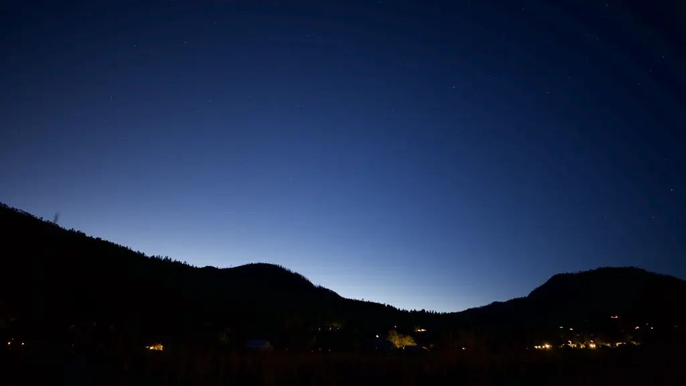
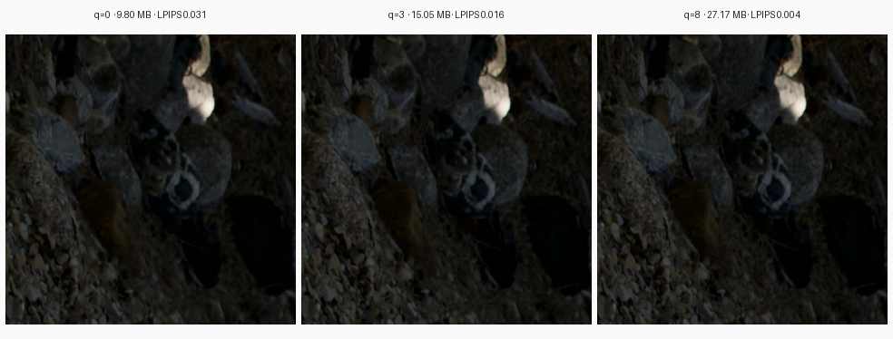
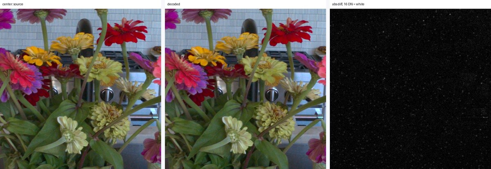
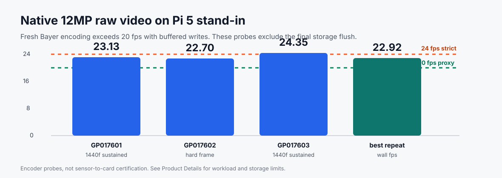
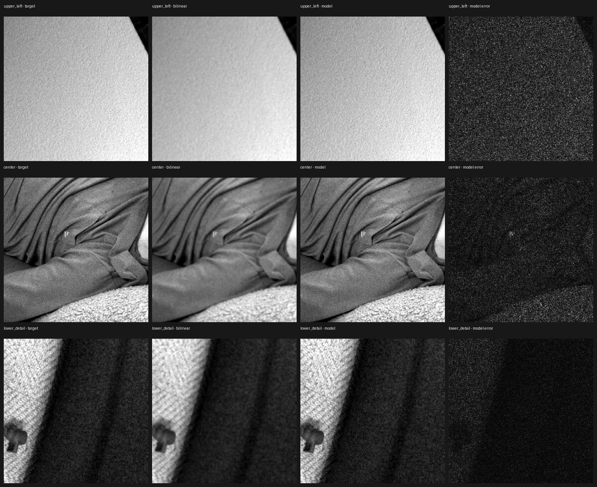
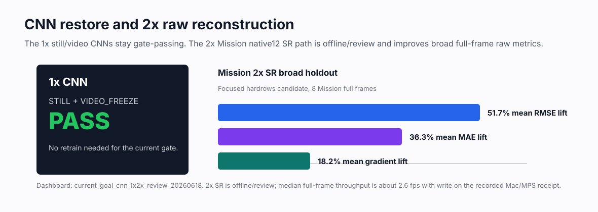
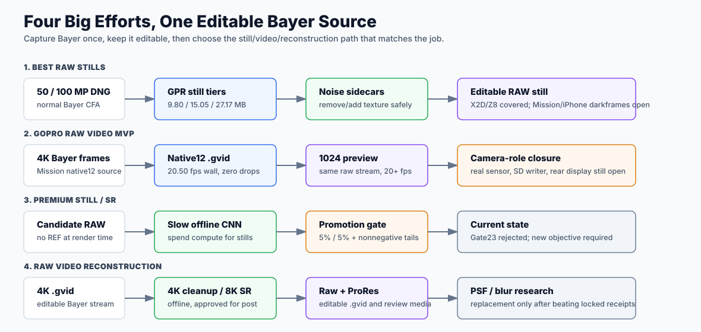

# dcliftreaves' GPR Additions

[](https://github.com/dcliftreaves/gpr/actions/workflows/ci.yml)
[](#license)

**8-bit JPEG size. 16-bit RAW quality.**

Faster RAW compression. RAW video capture and playback. Optional 4K-to-8K
super-resolution. This fork builds on GoPro's wavelet codec to keep the
sensor data when you shoot, so you can choose the finished look and
output resolution later.



## Better, Faster RAW Compression

GPR began with a useful idea: keep the flexibility of RAW without carrying huge
files everywhere. This fork adds faster compression, 14-bit and 16-bit support
alongside 12-bit Bayer, and optional desktop CNN restoration. Choose a smaller
file for everyday shooting or a higher-quality tier for a demanding edit;
the sensor data stays available in either case.



The tested 50 MP still tiers average **9.80 MB**, **15.05 MB**, and **27.17 MB**.
The two smaller tiers pair compression with desktop restoration; the largest
uses no CNN. The workflow also supports X2D 100 MP DNG roundtrips and the four
standard Bayer layouts: RGGB, GBRG, GRBG, and BGGR. File size and fidelity depend
on the scene and selected settings.

## RAW Video: Capture And Playback

The next step was to make that same idea continuous. Fresh 4K Bayer frames are
compressed into `.gvid`, an independently decodable RAW video stream. A native
preview path reads that stream and displays the full frame, so capture and
playback share the same recording. No CNN is needed on the camera side.



The Pi 5 evaluation path encodes **4096 x 3072 Bayer above 20 fps** with
buffered writes, and processes full-frame **1024 x 768 preview above 20 fps**.
Completed recording speed also depends on the storage device and its final
flush. Mission 1 still needs validation on its own sensor, card, and display.



## Super-Resolution: 4K To 8K

Capture has a deadline. Reconstruction can take its time. On the Mac, optional
CNNs restore 4K detail or reconstruct an 8K output from the recorded Bayer data.
These desktop paths support editable RAW workflows and ProRes rendering,
letting you choose the source format or a ready-to-edit movie for the next step.



The 8K alpha0p5 model is approved for offline production. The 4K cleanup
model has visual approval but remains registry review-only; visual signoff
does not automatically promote it. See [model scope](docs/RECONSTRUCTION.md#approval-boundary).
**Premium still/SR** is a separate, slower research effort for 50 MP and 100 MP
photography; a broadly improved replacement model has not yet passed its gate.
The existing still-restoration and video models remain available independently.



## How The Pieces Fit

Record once, then choose the output you need: a compact editable still, camera
preview, restored 4K, or reconstructed 8K. White balance and rendering happen
downstream of the Bayer recording, and ProRes is an output of that RAW workflow.



| Workflow | Output |
|---|---|
| RAW stills | Editable GPR/DNG, with optional desktop restoration |
| RAW video capture | 4K Bayer `.gvid` |
| Camera preview | Full-frame 1024 x 768 RGB from the same `.gvid` |
| Desktop reconstruction | 4K cleanup or 8K SR, editable Bayer and ProRes |
| MOV interchange | Wrap compressed RAW payloads without re-encoding |

## Try It

Build the SDK and command-line tools:

```bash
cmake -S . -B build -DCMAKE_BUILD_TYPE=Release
cmake --build build --parallel 4
```

The [getting-started guide](docs/GETTING_STARTED.md) covers conversion and video
workflows. GoPro engineers can start with the
[camera evaluation guide](https://github.com/dcliftreaves/gpr/blob/review/product-validation/docs/GOPRO_MISSION1_QUICK_VALIDATION.md).

For measurements, model availability, limitations, and the development history,
see [technical details and evidence](docs/PRODUCT_DETAILS.md).

## License

Dual licensed under Apache-2.0 or MIT. See [LICENSE.txt](LICENSE.txt).
Product names belong to their respective owners; this fork is an independent
extension of the GoPro SDK.
